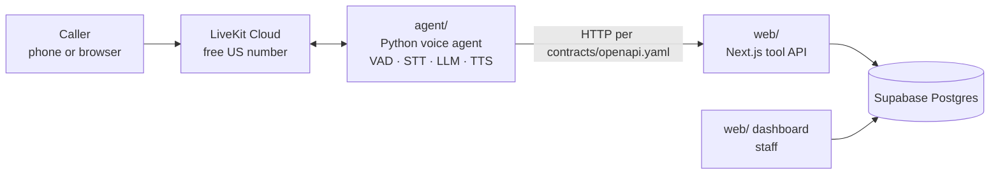

# gujju_assistant

An AI phone receptionist for restaurants. It answers calls, books, changes and cancels tables, answers menu and hours questions, and takes messages for staff. It speaks English and natural Gujarati, including Gujarati mixed with English, and it's built on free tiers and free models.



## Repository

| Folder | What it holds | Docs |
|---|---|---|
| [`agent/`](agent/) | Real-time voice agent (Python, LiveKit Agents) | [docs/agent.md](docs/agent.md) |
| [`web/`](web/) | Dashboard and tool API (Next.js, TypeScript, Supabase) | [docs/web.md](docs/web.md) |
| [`contracts/`](contracts/) | `openapi.yaml`: the only interface between the two | — |

The two halves meet only at `contracts/openapi.yaml`, and each folder has a single owner (see [`.github/CODEOWNERS`](.github/CODEOWNERS)). For the full project context and rules, see [CLAUDE.md](CLAUDE.md).

## Getting started

You can do the first two steps with no accounts or API keys. Add keys only when you reach the step that needs them.

### What to install

| Tool | Why | Install |
|---|---|---|
| [uv](https://docs.astral.sh/uv/) | Runs the agent. It installs Python 3.12 for you | `winget install astral-sh.uv`, or see its site |
| Node.js 22 and pnpm 9 | Run the web app | [nodejs.org](https://nodejs.org), then `npm install -g pnpm@9.15.5` |
| [LiveKit CLI](https://docs.livekit.io/home/cli/) | Browser calls and deployment (not needed for steps 1 to 3) | `winget install LiveKit.LiveKitCLI` |
| [ffmpeg](https://ffmpeg.org) | Only for the Gujarati audio tools | `winget install Gyan.FFmpeg` |

### 1. Get the code and run the tests

```sh
git clone https://github.com/shashankpithva/gujju_assistant-.git
cd gujju_assistant-/agent
uv sync
uv run pytest -q
```

All tests should pass with no keys set. If they do, your setup is good.

### 2. See the dashboard

```sh
cd ../web
pnpm install
pnpm dev
```

Open http://localhost:3000. With no database set up, it runs on built-in seed data, so you can look around straight away. The dashboard sign-in is a placeholder for now.

### 3. Talk to the agent

Create your settings file, from `agent/`:

```sh
cp .env.example .env
uv run python -m agent.main download-files    # once: turn detector and VAD weights
```

Fill in the keys for the language you want. The agent uses a built-in fictional restaurant, The Saffron Table, so you don't need the web app for this.

| To talk in | Keys in `agent/.env` |
|---|---|
| English | `DEEPGRAM_API_KEY`, plus `GROQ_API_KEY` or `GOOGLE_API_KEY` |
| Gujarati | `SARVAM_API_KEY`, plus `GROQ_API_KEY` or `GOOGLE_API_KEY`, and set `AGENT_LANGUAGE=gu` |

Then talk to it through your mic and speakers. Use headphones, or it may hear itself:

```sh
uv run python -m agent.main console
```

Here's where to get each key. All of them have a free tier or free credit.

| Key | Where |
|---|---|
| `DEEPGRAM_API_KEY` | [console.deepgram.com](https://console.deepgram.com) |
| `GROQ_API_KEY` | [console.groq.com](https://console.groq.com) |
| `GOOGLE_API_KEY` | [aistudio.google.com](https://aistudio.google.com) |
| `SARVAM_API_KEY` | [dashboard.sarvam.ai](https://dashboard.sarvam.ai) |
| `LIVEKIT_URL`, `LIVEKIT_API_KEY`, `LIVEKIT_API_SECRET` | [cloud.livekit.io](https://cloud.livekit.io), under Settings → API keys |

**Free LLM tiers may train on what you send, so use fake data only:** no real customers' names or numbers.

### 4. Call it from a browser

Add the three LiveKit values to `agent/.env`, then:

```sh
lk cloud auth                      # once: links the CLI to your LiveKit project
lk agent dev src/agent/main.py     # prints a link you can open to talk to it
```

### 5. Connect the agent to the web app

This makes bookings appear in the dashboard. Choose any long random string as the shared key, and put the same value in both files:

| File | Set |
|---|---|
| `agent/.env` | `DATA_SOURCE=api`, `API_BASE_URL=http://localhost:3000`, `AGENT_API_KEY=<the key>` |
| `web/.env.local` (copy of `web/.env.example`) | `AGENT_API_KEY=<the key>` |

Leave `DATABASE_URL` empty to stay on seed data, or see [Running with the web app](docs/agent.md#running-with-the-web-app) to use Supabase or a local Postgres. Run `pnpm dev` in `web/` and the agent at the same time.

## Everyday commands

```sh
# In agent/
uv run ruff format . && uv run ruff check . && uv run pytest -q    # what CI runs
uv run pytest evals -v                                             # real conversations: uses API quota

# In web/
pnpm typecheck && pnpm test && pnpm build                          # what CI runs
```

## How the code is laid out

| Start here | To understand |
|---|---|
| [agent/src/agent/main.py](agent/src/agent/main.py) | How a call starts and the voice pipeline is assembled |
| [agent/src/agent/tools.py](agent/src/agent/tools.py) | What the agent can do: bookings, menu, messages, hanging up |
| [agent/src/agent/guard.py](agent/src/agent/guard.py) | Checks that stop false bookings and invented prices |
| [agent/src/agent/languages.py](agent/src/agent/languages.py) | Which speech providers a call uses, set by environment variables |
| [agent/src/agent/gujarati/](agent/src/agent/gujarati/) | Gujarati numbers, times, days, goodbyes and fixed lines |
| [agent/src/agent/prompts/](agent/src/agent/prompts/) | The system prompts, one per language |
| [web/lib/reservations/](web/lib/reservations/) | Availability and booking logic |
| [contracts/openapi.yaml](contracts/openapi.yaml) | Every endpoint the agent can call |

## Rules to know before your first change

- **Stay on one side.** A change touches `agent/`, `web/` or `contracts/`, never more than one.
- **The agent never touches the database.** It talks to the web API over HTTP only.
- **Date and time maths belongs in the API**, not in the agent or the prompt.
- **Never commit `.env` files or secrets.** Add new variables to that folder's `.env.example`.
- **Use fake restaurants and callers** in fixtures and seeds, and never commit recordings of real people.
- **Don't remove the AI disclosure.** Every call says it's an AI, and the agent never claims to be a person.

## Gujarati status

Gujarati calls are built and tested in code, but **nobody has listened to them yet**. No voice has been chosen, the speech recognition hasn't been measured on real callers, and the 554-conversation dataset is synthetic and hasn't had native-speaker review. [agent/docs/gujarati/README.md](agent/docs/gujarati/README.md) walks through finishing that, and [audit.md](agent/docs/gujarati/audit.md) explains how it's built.

## If something goes wrong

| What you see | What to do |
|---|---|
| "Set GROQ_API_KEY and/or GOOGLE_API_KEY in agent/.env" | Add at least one of them |
| "Can't reach our booking system" on a call | With `DATA_SOURCE=api`, the web app must be running at `API_BASE_URL`. Or use `DATA_SOURCE=sample` |
| Replies get much slower after a while | You've probably hit Groq's free limits, so requests have moved to Gemini. See [Free-tier limits](docs/agent.md#free-tier-limits) |
| The agent interrupts itself | The mic is hearing the speakers: use headphones |
| A stale booking is in the way | Delete `agent/.sample_state.json` to reset the sample restaurant |
| Can't connect to Supabase | Use the session pooler URL, not the direct `db.` host. See [Running with the web app](docs/agent.md#running-with-the-web-app) |
