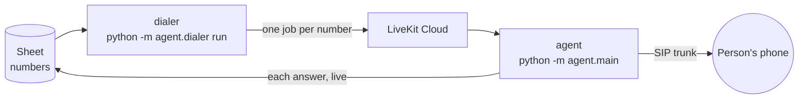

# Survey caller (`agent/`)

Owner: agent track (see [.github/CODEOWNERS](../.github/CODEOWNERS))

The agent phones each number in a sheet, asks seven questions about the water supply in Gujarati, writes every answer into the sheet the moment it's given, thanks the person and hangs up. It's a LiveKit voice agent: Sarvam hears and speaks Gujarati, and an LLM (Groq, with Gemini behind it) reads each answer.



## The call

After the person picks up and says "હેલો?", the agent introduces itself as an AI assistant and asks:

| # | Question | Example answers | In the sheet |
|---|---|---|---|
| 1 | તમારું નામ શું છે? | મારું નામ રમેશભાઈ પટેલ | રમેશભાઈ પટેલ |
| 2 | તમારું ગામ કે શહેર કયું છે? | ખાંભા | ખાંભા (Khambha) |
| 3 | તાલુકો કયો છે? | ખાંભા જ | ખાંભા (Khambha) |
| 4 | અને જિલ્લો કયો છે? | અમરેલી | અમરેલી (Amreli) |
| 5 | તમારે ત્યાં પાણી આવે છે? | હા / ના | હા / ના |
| 6 | પાણી કેટલા દિવસે આવે છે? | રોજ, એકાંતરે, ત્રણ દિવસે એક વાર | રોજ, એકાંતરે (દર 2 દિવસે) |
| 7 | દિવસમાં કેટલો સમય પાણી આવે છે? | અડધો કલાક, સવારે છ થી આઠ | અડધો કલાક (30 મિનિટ) |

If water doesn't come, questions 6 and 7 are skipped. Each village, taluka and district is checked against the list of Gujarat's places and read back, and goes in the sheet only after the person says yes ([below](#places-checked-and-confirmed)). A call goes like this:

> **AI:** નમસ્તે! હું ગ્રામ પંચાયત તરફથી AI આસિસ્ટન્ટ બોલું છું. પાણીની સુવિધા વિશે બે મિનિટનો નાનો સર્વે છે. તમારું નામ શું છે?<br>
> **Person:** મારું નામ રમેશભાઈ પટેલ.<br>
> **AI:** આભાર, રમેશભાઈ પટેલ. તમારું ગામ કે શહેર કયું છે?<br>
> **Person:** ખાંભા, તાલુકો ખાંભા ને જિલ્લો અમરેલી.<br>
> **AI:** ખાંભા ગામ, ખાંભા તાલુકો અને અમરેલી જિલ્લો, બરાબર?<br>
> **Person:** હા.<br>
> **AI:** સારું. હવે પાણી વિશે પૂછું. તમારે ત્યાં પાણી આવે છે?<br>
> **Person:** હા, એકાંતરે આવે છે.<br>
> **AI:** બરાબર, પાણી આવે છે અને એકાંતરે. દિવસમાં કેટલો સમય પાણી આવે છે?<br>
> **Person:** માંડ અડધો કલાક.<br>
> **AI:** અડધો કલાક, બરાબર. તમારી બધી માહિતી નોંધાઈ ગઈ છે. સમય આપવા બદલ ખૂબ ખૂબ આભાર. આવજો!

What it handles:
- **Several answers at once**, as above, and **corrections** ("ના, ગામ ખાંભા નહીં, ખંભાળિયા") at any point.
- **Saying back** each answer, so a misheard one gets corrected straight away. Places wait for a yes.
- **"શું?"** repeats the question. **"તમે કોણ બોલો છો?"** and **"આ શેના માટે?"** get an answer, then the question again.
- **Unclear answers** get the question in other words. After three tries the survey moves on and the sheet says `(સ્પષ્ટ નથી)`, so a call never goes round in circles.
- **"એક મિનિટ"** (hold on): it waits, and is three times as patient with the silence.
- **"હું બિઝી છું, પછી ફોન કરજો"** ends politely as `busy`, to be called again. **Not interested** ends as `declined`.
- **Silence**: "હેલો, તમને મારો અવાજ સંભળાય છે?", then goodbye if there's still nothing.
- **A hang-up** keeps whatever was answered, as `partial`.

## Places: checked and confirmed

The agent knows every district (34), taluka (299), village (19,105) and town (168) in Gujarat, from the government's Local Government Directory as of May 2026, so it has Vav-Tharad and the talukas made in October 2025. Where the list comes from, and how to update it: [places/data/README.md](../agent/src/agent/places/data/README.md).

For a village, taluka or district, the agent:

1. **Finds it in the list by how it sounds**, so the spellings speech-to-text gives (ખાંભા, ખંભા) and English spellings (Khambha) find the same place. Speech-to-text often drops or changes a sound, so a near miss is found too, and the yes in step 2 catches a wrong guess. The village question also finds towns and cities, and some places have other names: Baroda is Vadodara, Rajpipla is Nandod taluka, Bhuj is Kachchh district.
2. **Reads it back for a yes:** "તમારું ગામ ખાંભા, બરાબર?", "ખાંભા તાલુકો, બરાબર?", "અમરેલી જિલ્લો, બરાબર?". If they used another name for it, it reads back the official one ("બરોડા" is read back as "વડોદરા"), so they say yes to what goes in the sheet. Places said together are read back together.
3. **Writes it only after a yes**, as `ખાંભા (Khambha)`: their own Gujarati, then the official name. "ના" asks for it again. "ના, ખંભાળિયા" checks the new name and reads that back.
4. **Asks again if it isn't in the list:** "માફ કરજો, આ નામ મારી યાદીમાં નથી. ગામ કે શહેરનું નામ ફરીથી કહેશો?". After three tries it moves on. The cell says `(સ્પષ્ટ નથી)` and Notes says what was heard: `Village not in the list (heard: ...)`.

Other places can share a name: there are 73 Navagams, and two Kalols. The taluka narrows down the village, and the district narrows down the taluka. If the person confirms places that don't fit together in the list (a village that's in a different taluka), each is still written as they said it, and Notes says `Check: ...`. If the call ends before a yes, the place isn't written; Notes says `Village not confirmed (heard: ...)`.

`PLACE_CHECK=off` turns the list off: any name is read back as heard, and still needs a yes.

## The sheet

Put phone numbers in a column headed `Phone` (or `ફોન નંબર`, `Mobile`...). That's all the sheet needs: the first time it's read, the other columns are added after your own, which stay as they are. Numbers can be written any way: `98765 43210`, `+91-98765-43210`, `09876543210`. Ten digits are taken as Indian (`DEFAULT_COUNTRY_CODE`). [contacts.example.csv](../agent/contacts.example.csv) is an empty sheet with every column.

| Column | Filled by | What it holds |
|---|---|---|
| Phone / ફોન નંબર | you | The number to call |
| Name, Village, Taluka, District, Water comes?, How often, Time per day | agent | The answers, as each one is given |
| Status | dialer, agent | Empty: not called yet. `calling` during the call, then `completed`, `partial`, `busy`, `no_answer`, `declined` or `failed` |
| Attempts | dialer | Calls made to this number |
| Last call | dialer, agent | When, in `SURVEY_TIMEZONE` |
| Notes | agent | How it went: `Busy or rejected (486 Busy Here)`, `Call ended at the village question`, `Unclear: name`, `Village not in the list (heard: ...)` |
| Call ID | agent | The call's id, as in the agent's log |
| Transcript | agent | The whole conversation |

`dialer run` calls every number with no status, and calls `busy`, `no_answer` and `failed` numbers again until they've had two attempts (`--max-attempts`). It never calls a `completed`, `partial` or `declined` number again; clear its Status to call it again.

## Set up

Everything runs from `agent/`. The first two steps need no accounts.

### 1. Install and run the tests

```sh
cd agent
uv sync
uv run pytest -q          # about 400 tests, a few seconds, no keys needed
cp .env.example .env
uv run python -m agent.main download-files    # once: the turn detector and VAD weights
```

### 2. Keys

In `agent/.env`, set at least:

| Key | Where | What for |
|---|---|---|
| `SARVAM_API_KEY` | [dashboard.sarvam.ai](https://dashboard.sarvam.ai) | Hearing and speaking Gujarati |
| `GROQ_API_KEY` and/or `GOOGLE_API_KEY` | [console.groq.com](https://console.groq.com), [aistudio.google.com](https://aistudio.google.com) | Reading the answers |
| `LIVEKIT_URL`, `LIVEKIT_API_KEY`, `LIVEKIT_API_SECRET` | [cloud.livekit.io](https://cloud.livekit.io), Settings → API keys | Phone calls |

`uv run python scripts/check_providers.py` checks which Sarvam voices and STT options, and which LLMs, your keys can really use (it costs a few rupees of Sarvam credit).

### 3. Talk to it in the terminal

With `SURVEY_CSV=contacts.csv` in `.env` (the default) and headphones on:

```sh
uv run python -m agent.main console
```

You get the whole survey through your microphone, and a new row in `contacts.csv` with your answers. Do this before the first real call: it tries the voice, the hearing, the LLM and the sheet together.

### 4. The sheet

**Google Sheets** (for the demo: the answers appear as people speak). The agent signs in as a *service account*, a robot Google account:

1. In the [Google Cloud console](https://console.cloud.google.com), create a project (or use one), then under APIs & Services → Library, enable the **Google Sheets API**.
2. Under APIs & Services → Credentials, choose Create credentials → **Service account**. Give it a name, then Done.
3. Open the service account, then Keys → Add key → Create new key → **JSON**. Save the file as `agent/service-account.json` (git and the Docker image both ignore it). It's a password: never send it around.
4. Open your sheet in Google Sheets and **Share** it with the service account's email (`client_email` in the file, `...@....iam.gserviceaccount.com`) as an **Editor**.
5. In `.env`, set `GOOGLE_SHEET_ID` to the sheet's address (or just its id). `GOOGLE_SHEET_TAB` picks a tab; empty means the first.

**A CSV file** works too, with `GOOGLE_SHEET_ID` empty and `SURVEY_CSV=contacts.csv`. It's saved so Excel shows Gujarati, but close it in Excel during calls (Excel locks it). A CSV only works while the agent runs on the same computer (`agent.main dev`), not deployed.

### 5. The phone line

Outbound calls go through a **SIP trunk**: a phone line from a telephony provider that can call the numbers you want (for India, an Indian provider such as Exotel or Plivo, or any SIP provider that can reach Indian mobiles). The provider gives you a SIP address, a phone number and usually a username and password. Then, once:

```sh
uv run python -m agent.dialer setup-trunk --address <sip address> --number <+91...> --username <user> --password <password>
```

It prints `SIP_OUTBOUND_TRUNK_ID=ST_...`: put that line in `.env`.

### 6. Check

```sh
uv run python -m agent.dialer check
```

It checks the keys, LiveKit, the phone line and the sheet, and says what to fix.

## Run the survey

In one terminal, start the agent. It waits for calls:

```sh
uv run python -m agent.main dev
```

In another, call yourself first, then everyone:

```sh
uv run python -m agent.dialer call +919876543210   # adds the number to the sheet and calls it
uv run python -m agent.dialer run                  # everyone not called yet, one after another
uv run python -m agent.dialer run --limit 5        # only the next five
uv run python -m agent.dialer run --dry-run        # only show who would be called
uv run python -m agent.dialer list                 # the sheet, from the terminal
```

Calls go out one at a time, with a few seconds between them. Each waits for the previous one to end, which suits the free tiers. The dialer only calls between 9 AM and 9 PM (`SURVEY_CALL_HOURS`); add `--any-time` to call outside those hours, for example your own phone. Stopping the dialer (Ctrl+C) lets a call in progress finish.

### Demo checklist

1. `dialer check` shows no FAIL.
2. A console call (`agent.main console`) the same day: the voice, the hearing and the sheet all work.
3. The agent running (`agent.main dev`) or deployed, before the dialer starts.
4. `dialer call` to your own phone, with the Google Sheet open on screen: each answer appears in its row as you say it.
5. Then `dialer run` on the demo list: people who agreed to be called.

## Deploy to LiveKit Cloud

So the agent takes calls without your computer. LiveKit builds the image from [Dockerfile](../agent/Dockerfile). Put the settings in `agent/.env.production`, which git and the upload both ignore. That means everything from `.env` except the three `LIVEKIT_` values, which LiveKit sets itself. The service account key goes in as text: `GOOGLE_SERVICE_ACCOUNT_JSON` holds the key file's contents (or their base64), since a deployed agent has no file to read.

```sh
lk cloud auth                                                          # once
lk agent deploy                                                        # this repo's livekit.toml names the agent
lk agent update-secrets --secrets-file .env.production --overwrite     # after changing a setting
lk agent logs
```

A deployed agent needs the Google Sheet: it can't see a CSV on your computer. The dialer still runs on your computer, with the same `AGENT_NAME`. On the free plan an idle agent sleeps, and the first call waits 10–20 s for it to wake. The dialer allows for that.

## How it works

| File | What it does |
|---|---|
| [survey/script.py](../agent/src/agent/survey/script.py) | Every question and fixed line, in Gujarati |
| [survey/flow.py](../agent/src/agent/survey/flow.py) | Where the call is: takes what was understood and picks the next line |
| [survey/reader.py](../agent/src/agent/survey/reader.py) | Reads a turn: rules for plain answers, the LLM for the rest, rules again if the LLM fails |
| [survey/answers.py](../agent/src/agent/survey/answers.py) | Cleaning and checking answers; days and hours in Gujarati; how the sheet shows them |
| [survey/agent.py](../agent/src/agent/survey/agent.py) | The LiveKit agent: one reading per turn, one line back |
| [survey/controls.py](../agent/src/agent/survey/controls.py) | Silence, lost words, the time limit, hanging up |
| [places/](../agent/src/agent/places/) | Gujarat's districts, talukas, villages and towns; finding a place by how its name sounds |
| [survey/recorder.py](../agent/src/agent/survey/recorder.py) | Writes answers into the row in the background, during the call |
| [sheets/](../agent/src/agent/sheets/) | Google Sheets and CSV: header detection, cells in, contacts out |
| [main.py](../agent/src/agent/main.py) | One call: dial, wait for "હેલો?", run the survey, save the result |
| [dialer.py](../agent/src/agent/dialer.py) | Reads the sheet and sends the agent to each number |
| [outbound.py](../agent/src/agent/outbound.py) | The call request, the SIP dial, and what a failed dial means |
| [languages.py](../agent/src/agent/languages.py) | Sarvam hearing and voice, the turn detector |
| [gujarati/](../agent/src/agent/gujarati/) | Gujarati numbers and times, text for the voice, the style linter |

**The LLM never decides what to say.** On each turn the reader asks it one small question, "what did the person answer?", and it must reply with a function call (`record_answer`), never with words. The flow then picks the next line from the script. So the call can't drift off-topic, invent a question, or forget where it was after an answer it didn't expect. Short answers the rules understand completely ("હા", "રોજ", "અડધો કલાક") skip the LLM altogether: about a second sooner, and one request fewer against the free tier. When the LLM fails or is slow (5 s), the rules read the answer instead, so the call carries on.

**The sheet fills in live.** Each answer is written to its row in the background while the call goes on, and a final write at the end holds every answer, the status and the transcript. A failed write is logged and retried with the next, and never interrupts the call.

### The problem after the name, and what fixed it

On the old receptionist, things went wrong after it asked for the name. Three causes, each fixed:

1. **The LLM chose the next step.** It had to call the right tool again with the name. When it replied in words instead, the name was lost and the call lost its place. Now the flow decides every step, and the LLM only reads answers.
2. **Short answers could vanish.** A name is often one short word. Sarvam's streaming STT finds speech with its own detector, and a short word sometimes came back with no transcript at all. LiveKit only ends a turn once words arrive, so the agent sat silent until the silence check-in. Now speech that brings no words gets the question again after 3 s (`TRANSCRIPTION_TIMEOUT_SECONDS`), at most twice in a row.
3. **Long waits after a bare answer.** The turn detector doesn't know Gujarati, and when unsure it waited up to 3 s after "રમેશ". The wait is now capped at 2 s, with a 0.7 s floor so "મારું નામ… રમેશ" isn't cut after "નામ". If it is, the next turn is read together with it.

`SARVAM_STT_FLUSH=on` goes further: LiveKit asks Sarvam for the words the moment a turn ends, instead of waiting for Sarvam's own end-of-speech detection. It uses Sarvam's documented flush signal but hasn't been tried on live calls yet, so it's off by default. Try it on a test call; if replies come sooner and nothing is lost, keep it.

## Settings

All in [.env.example](../agent/.env.example), each explained in place. The ones to know:

| Setting | Default | What it does |
|---|---|---|
| `SURVEY_ORG_NAME` | empty | Who the call is from, said in the introduction: `ગ્રામ પંચાયત` |
| `SURVEY_PURPOSE` | about collecting water information | The answer to "why are you asking?" |
| `PLACE_CHECK` | `on` | Check villages, talukas and districts against the list of Gujarat's places |
| `SURVEY_CALL_HOURS` | `9-21` | When the dialer may call |
| `MAX_CALL_SECONDS` | 240 | Longest call |
| `SILENCE_CHECK_IN_SECONDS` | 8 | Silence before "હેલો, ... સંભળાય છે?", and again before hanging up |
| `ENDPOINTING_MIN_DELAY`, `ENDPOINTING_MAX_DELAY` | 0.7, 2.0 | How long a pause ends an answer |
| `TRANSCRIPTION_TIMEOUT_SECONDS` | 3 | Speech with no words: ask again after this long |
| `SARVAM_TTS_SPEAKER`, `SARVAM_TTS_PACE` | `shubh`, 1.0 | The voice, and how fast it speaks (0.9 for older people) |
| `LLM_PROVIDER`, `GROQ_MODELS` | `groq`, gpt-oss-120b then 20b | Which LLM reads answers first |

## Checks

```sh
uv run ruff format . && uv run ruff check . && uv run pytest -q    # what CI runs; no keys needed
uv run pytest evals -v                                             # the real LLM reading real answers
```

[tests/](../agent/tests/) cover the flow, the reader, the rules, the list of places, both sheets, the dialer and the call controls. [test_session.py](../agent/tests/test_session.py) runs whole surveys through LiveKit's own `AgentSession` with a scripted LLM, including the after-the-name cases and a failed LLM.

[evals/test_reading.py](../agent/evals/test_reading.py) gives the real LLM 29 answers as people really say them: names, places, corrections, numbers of days and hours, "hold on", busy, "yes" to "can you hear me?", and yes or no to a place read back. It uses one request per case, so it isn't in CI. Run it after changing the reader's instructions or the model, and compare models with `GROQ_MODELS=openai/gpt-oss-20b uv run pytest evals -v` or `LLM_PROVIDER=gemini`.

## Latency

Every reply logs a line like `turn 4 latency | total 1320 ms | eou 610 | stt 480 | llm ttft 700 ...`, and each turn of the survey logs what was understood: `survey | +9198xxxxx210 | asked village | answer (llm) {'village': 'ખાંભા'}`. At the end of the call, a summary gives the p50 and p95. Replies the rules read have no LLM time at all.

## If something goes wrong

| What you see | What to do |
|---|---|
| `dialer check` says FAIL | Do what it says, then run it again |
| `No agent took the call` in Notes | Start `uv run python -m agent.main dev` (or deploy), with the same `AGENT_NAME` as the dialer |
| Every call `failed` with a SIP 401/403 | The trunk's username or password is wrong: run `setup-trunk` again with the provider's details |
| Calls `no_answer` at once | The provider can't reach that number, or the number is off. Try your own number first |
| `Can't open the Google Sheet` | Share the sheet with the service account's email as an Editor, and check `GOOGLE_SHEET_ID` |
| `Can't write contacts.csv: close it in Excel` | Close the file in Excel during calls, or use a Google Sheet |
| The agent hears itself in console mode | Use headphones |
| The agent asks again after every short answer | The STT is losing short words: try `SARVAM_STT_FLUSH=on`, or `STT_PROVIDER=sarvam-realtime` if your Sarvam plan has it |
| Replies get slow after many calls | The free Groq budget ran out and requests moved to Gemini. Wait, or use Groq's paid tier |

## Calling people responsibly

- **Only call people who agreed to be called.** The agent says it's an AI in its first sentence and whenever asked, and never claims to be a person. Keep it that way.
- India's TRAI rules treat AI calls as automated calls. Before calling the public (not a demo with people who agreed), get a view on consent, DND and calling hours, and use a phone line registered for it.
- The sheet holds names, villages and transcripts, which are personal data under India's DPDP Act. Share it only with those who need it, and delete what you no longer need.
- **Free LLM tiers may use what you send them for training.** The reader sends each answer to Groq or Gemini, so for real people's data use a paid tier with suitable data terms.
